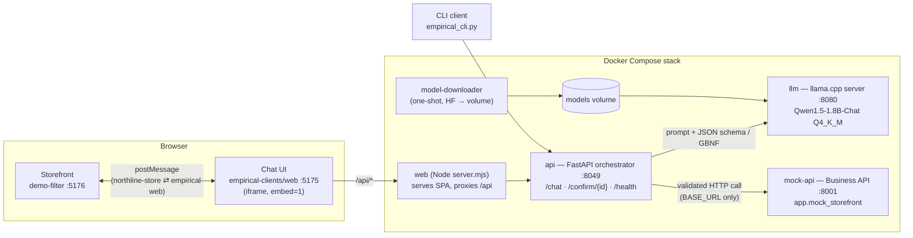
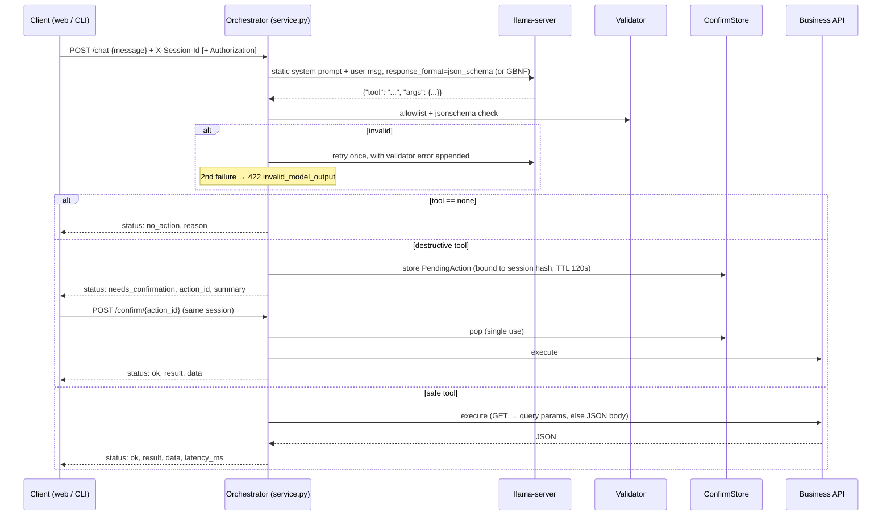

# Empirical — Big Picture

**Empirical** turns plain-English chat messages into **validated REST API calls**, using a small local LLM (Qwen1.5-1.8B GGUF on llama.cpp, CPU only).
The repo is a monorepo with three apps and one Docker Compose stack that runs them together as a demo: a fake shop ("Northline Supply Co.") that you can drive by chatting.

> Core idea: the LLM only *proposes* a JSON `{tool, args}`. Python code checks it against an allowlist and a JSON schema, asks the user to confirm destructive actions, and then makes the HTTP call. The model never sees credentials and never calls the API itself.

---

## 1. Repository map

```text
empirical/
├── empirical-api/          Python / FastAPI — the orchestrator (the core product)
│   ├── app/                main, service, llm, registry, validator, executor, confirm_store, …
│   ├── app/mock_storefront.py   mock "Business API" (100-product catalog + cart)
│   ├── tools.json          tool registry (dev)      tools-prod.json (prod variant)
│   ├── tests/              pytest suite (fake LLM, in-process mock API)
│   ├── docker/             model-downloader image
│   └── *.spec              PyInstaller specs (Windows / CLI executables)
│
├── empirical-clients/
│   ├── web/                React + Vite + Tailwind chat UI (+ Node prod server that proxies /api)
│   └── cli/                stdlib-only Python REPL / one-shot client
│
├── demo-filter/            React + Vite storefront "Northline Supply Co."
│   ├── src/                catalog, filters, cart, checkout, embedded chat panel
│   ├── empirical/tools.json     ← tool registry the compose stack actually mounts
│   ├── mock-server.mjs     Node mock product API (alternative to the Python mock)
│   └── scripts/            product generator, image helpers, run-empirical-demo.sh
│
├── docker-compose.yml        VPS / public deployment (Traefik, TLS)
├── docker-compose-local.yml  local deployment (host ports)
└── .env.example              ports, model, origins, domains
```

---

## 2. Runtime architecture



**Startup order (healthchecks gate each step):**
`model-downloader` → `llm` → `mock-api` → `api` → `web` → `storefront`

**Ports** (from `.env.example`): API `8049`, mock API `8001`, web chat `5175`, storefront `5176`.
In `docker-compose.yml` the web chat and storefront sit behind **Traefik** on `WEB_DOMAIN` / `STOREFRONT_DOMAIN` with Let's Encrypt; in `docker-compose-local.yml` they are exposed on host ports.

---

## 3. Request lifecycle (`POST /chat`)



Every response has `latency_ms` = `{queue, llm, validate, api, total}`.

---

## 4. The tool registry — single source of truth

`tools.json` defines everything the system can do. At startup [registry.py](empirical-api/app/registry.py) turns it into:

1. the **static system prompt** (with few-shot examples, kept identical across requests so llama.cpp can reuse the KV cache),
2. a **JSON schema** (`oneOf` over all tools) for llama.cpp structured output,
3. a **GBNF grammar** to fall back on if the server rejects `response_format`,
4. per-tool **jsonschema validators**,
5. **result / confirmation templates**.

Current tools (same in all three `tools.json` files):

| Tool | Method / URL | Destructive |
|---|---|---|
| `search_products` | `GET /actions/search-products` | – |
| `add_to_cart` | `POST /actions/cart` | – |
| `remove_from_cart` | `POST /actions/cart/remove` | ✅ needs confirm |
| `empty_cart` | `POST /actions/cart/clear` | ✅ needs confirm |
| `open_product` | `GET /actions/product` | – |
| `navigate` | `GET /actions/navigate` | – |
| `none` | not executable (fallback) | – |

Registry rules: no duplicate names, no absolute URLs, `none` must exist, `additionalProperties: false`, and DELETE/PUT/PATCH must be marked destructive.

---

## 5. Component responsibilities

### empirical-api (Python 3.11, FastAPI; deps: fastapi, uvicorn, httpx, pydantic, jsonschema)
| Module | Role |
|---|---|
| [main.py](empirical-api/app/main.py) | App factory, routes, request-id middleware, error handlers, TTL cleanup loop |
| [service.py](empirical-api/app/service.py) | `Orchestrator`: propose → validate → retry → confirm/execute; identity hashing |
| [llm.py](empirical-api/app/llm.py) | Async llama-server client, concurrency semaphore, json_schema → GBNF fallback |
| [registry.py](empirical-api/app/registry.py) | Loads `tools.json`, builds prompt, schema, grammar, templates |
| [validator.py](empirical-api/app/validator.py) | Parses model output, allowlist and schema checks |
| [executor.py](empirical-api/app/executor.py) | Registry-driven HTTP calls, restricted to `BASE_URL`, forwards `Authorization` |
| [confirm_store.py](empirical-api/app/confirm_store.py) | `ConfirmStore` protocol + in-memory TTL store |
| [catalog_terms.py](empirical-api/app/catalog_terms.py) | Catalog synonyms / term normalisation |
| [mock_storefront.py](empirical-api/app/mock_storefront.py) | Mock Business API; same deterministic catalog as the storefront |
| config / errors / models / observability | Env config, error codes, data models, JSON logging |

### empirical-clients/web (React, Vite, TS, Tailwind, Zustand)
ChatGPT-style UI: conversation sidebar, history in localStorage, confirm cards, result cards, settings (backend URL, session, token).
With `?embed=1&hostOrigin=…` it runs inside the storefront iframe and sends results to the host via [embed.ts](empirical-clients/web/src/lib/embed.ts) / `useEmbedBridge`.
[server.mjs](empirical-clients/web/server.mjs) serves the build and proxies `/api` to `EMPIRICAL_API_URL`, so CORS is not needed.

### empirical-clients/cli
Dependency-free Python REPL / one-shot client for the same three endpoints.

### demo-filter — "Northline Supply Co." storefront (React, Vite, Zustand)
100 generated products, URL-synced filters, product pages, cart drawer, demo checkout and orders (all in localStorage).
The **Ask Empirical** launcher opens the chat in an iframe. [useEmpiricalBridge.ts](demo-filter/src/hooks/useEmpiricalBridge.ts) receives tool results and **applies them to the UI**:

| Tool result | Storefront effect |
|---|---|
| `search_products` | updates catalog filters / URL |
| `add_to_cart` / `remove_from_cart` / `empty_cart` | updates the cart store and shows a toast |
| `open_product` | goes to `/product/:id` |
| `navigate` | goes to home / cart / checkout |
| `needs_confirmation` / `no_action` | shows an info toast |

The Python mock API and the storefront's `products.json` are built with the same generator rules, so product IDs from the chat match the IDs in the UI.

---

## 6. Design principles & safety model

- **Constrained output**: grammar / JSON-schema decoding, temperature 0, `max_tokens` 80.
- **Defence in depth**: allowlist → schema validation → confirmation for destructive tools. A prompt injection can at most trigger a safe, allowed action.
- **Executor sandbox**: only calls `BASE_URL`, refuses redirects, credentials never reach the model or the logs.
- **Confirmations**: single-use, bound to the session hash, expire (TTL), consumed before execution.
- **Stateless chat**: no conversation memory on the server; history lives in the clients.
- **Single process**: in-memory store + one LLM semaphore → run **1 uvicorn worker**. Scaling out needs a Redis `ConfirmStore` and a shared queue.
- **No heavy stack**: no RAG, vector DB, LangChain, or second LLM call.

---

## 7. Testing

| Area | How |
|---|---|
| empirical-api | `pytest -q`: fake LLM, in-process ASGI mock API, injectable clock (no model, no network). Optional `RUN_LIVE_LLM=1` live test. |
| demo-filter | Vitest: filters, cart store, tool action mapping |
| CLI | `cli/test_cli.py` |

---

## 8. Things worth knowing / loose ends

- **tools.json exists three times** (`empirical-api/tools.json`, `demo-filter/empirical/tools.json`, plus `*-prod.json` variants). Compose mounts the **demo-filter** copy, so keep them in sync.
- `docker-compose.yml` mounts an **absolute VPS path** (`/root/empirical/demo-filter/empirical/tools.json`), so on a dev machine use `docker-compose-local.yml`.
- `demo-filter/scripts/run-empirical-demo.sh` defaults to `tools.ecommerce.json`, which is not in the repo.
- The `empirical-clients` README says the API runs on port `8000`; the compose stack uses `8049`.
- The PyInstaller `*.spec` files contain absolute Linux paths from one developer's machine.
- Language: English only. Reference latency: about 1.5–3 s per request on a 4-core CPU.
