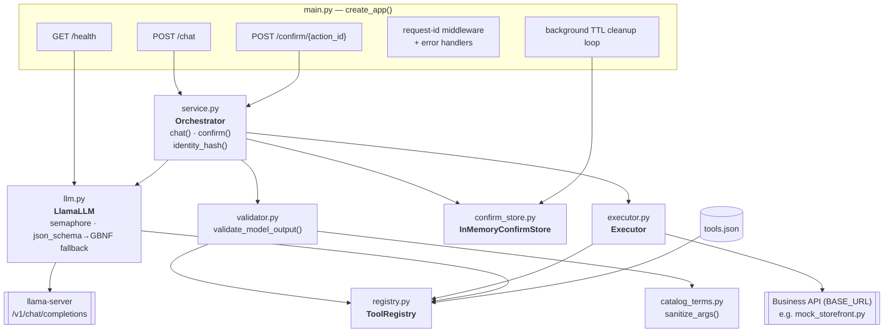
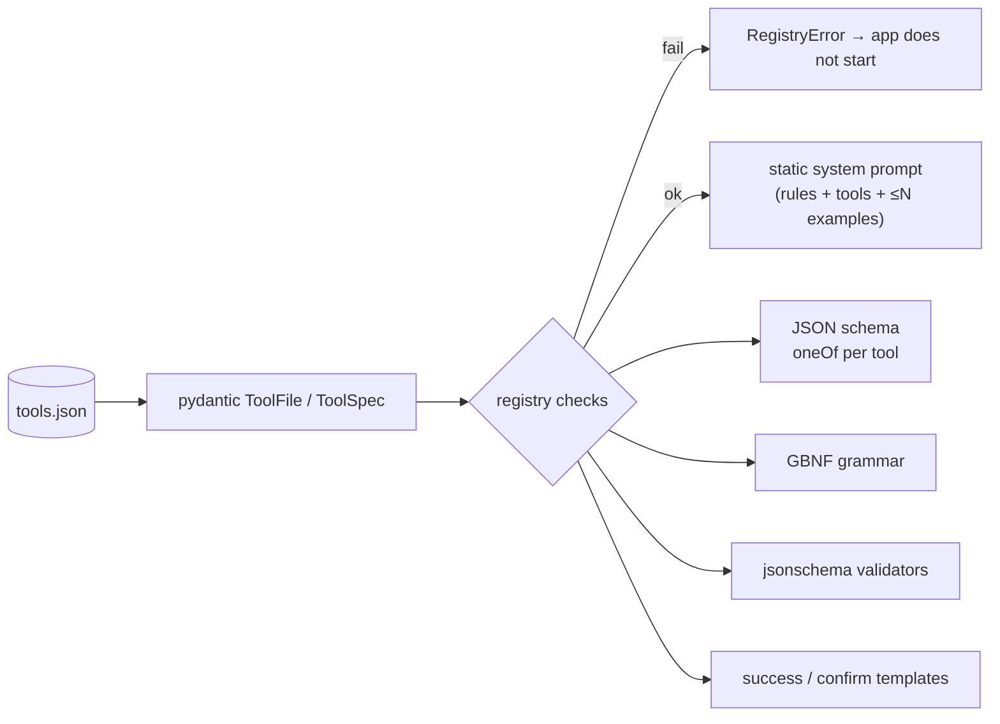
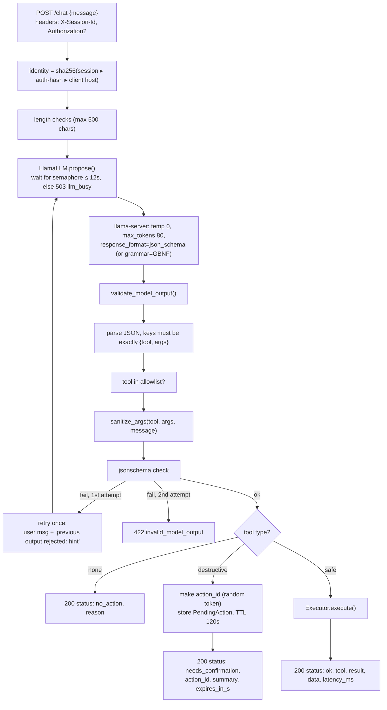
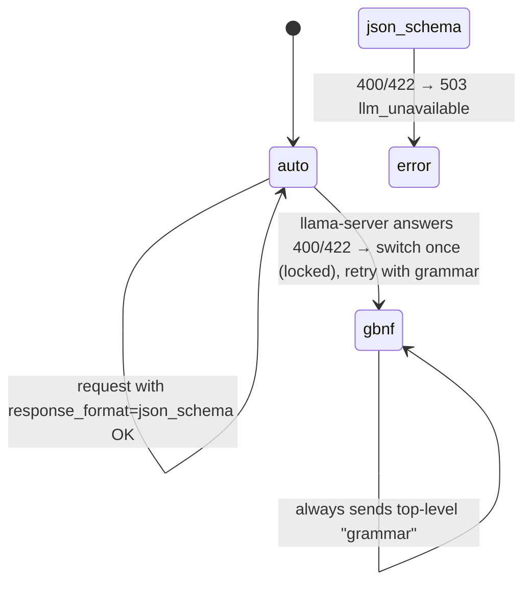
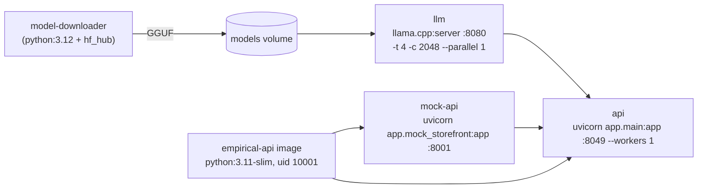

# empirical-api — Big Picture

A small FastAPI service that turns **one English chat message into one checked REST call**.
A local CPU LLM (Qwen1.5-1.8B on llama.cpp) only *suggests* `{"tool": ..., "args": {...}}`.
Python code checks, corrects, confirms and executes that suggestion.

```text
Client ──► /chat ──► LLM proposes JSON ──► validate (+ sanitize, 1 retry)
                                              │
                    none ◄────────────────────┼────────────────► safe tool ──► Business API
                 (no_action)                  │
                                     destructive tool
                                              │
                              ConfirmStore ──► /confirm/{id} ──► Business API
```

---

## 1. Components and dependencies



Shared modules: `config.py` (Settings from env), `models.py` (data types), `errors.py` (error codes → HTTP status), `observability.py` (JSON logs).

Everything is wired in `create_app()`. Every part can be injected (`registry`, `llm`, `store`, `api_client`, `clock`), which is how the tests replace the LLM and the network.

---

## 2. Module map

| File | Main type / function | Responsibility |
|---|---|---|
| [main.py](app/main.py) | `create_app()` | Builds everything, defines routes, request-id header, error handlers, TTL cleanup task, shutdown |
| [service.py](app/service.py) | `Orchestrator` | The pipeline: propose → validate → retry once → `none` / confirm / execute; latency breakdown |
| [llm.py](app/llm.py) | `LlamaLLM` | Calls llama-server with a concurrency semaphore (`llm_busy` if the wait times out) and falls back from json_schema to GBNF |
| [registry.py](app/registry.py) | `ToolRegistry` | Loads and checks `tools.json`; builds the system prompt, JSON schema, GBNF grammar, validators and templates |
| [validator.py](app/validator.py) | `validate_model_output()` | Checks the JSON shape, allowlist and schema; produces the retry hint |
| [catalog_terms.py](app/catalog_terms.py) | `sanitize_args()` | Checks the model's args against the **user's own words** (color, category, price, qty) |
| [executor.py](app/executor.py) | `Executor` | Renders the URL, enforces the same origin, sends query params or a JSON body, forwards `Authorization`, renders the result |
| [confirm_store.py](app/confirm_store.py) | `ConfirmStore`, `InMemoryConfirmStore` | Pending destructive actions: TTL, single use, bound to the caller |
| [models.py](app/models.py) | `ToolSpec`, `PendingAction`, `LLMResult`, `ExecutionResult` | Data types |
| [errors.py](app/errors.py) | `ServiceError` + subclasses | Stable error `code` → HTTP status |
| [config.py](app/config.py) | `Settings.from_env()` | Environment config, `TIMEOUTS` JSON |
| [observability.py](app/observability.py) | `log_event()` | One-line JSON logs on stdout |
| [mock_storefront.py](app/mock_storefront.py) | `MockStorefront` | **Separate app**: demo Business API with 100 products (same seeded generator as the React storefront) and a cart |

---

## 3. Startup: `tools.json` → registry artefacts



Registry checks: unique names, a `none` tool must exist, relative URLs only, `additionalProperties: false`, URL placeholders must match the args, every example must pass its own schema, and DELETE/PUT/PATCH must be `destructive`.

The system prompt is **byte-identical on every request**. The user's message (and the retry error, if any) goes only in the user turn, so llama.cpp can reuse the KV cache for the prompt prefix (`cache_prompt: true`).

---

## 4. `POST /chat` step by step



### `POST /confirm/{action_id}`

1. Compute the same identity hash as `/chat`.
2. `store.pop(action_id, identity)` removes the action **before** running it (single use; replays → 404). The identity check uses `hmac.compare_digest`.
3. Check the tool still exists in the registry and is executable.
4. `Executor.execute()` with the stored args. `Authorization` is **not** stored, so the client must send it again.
5. Any failure (unknown, expired, wrong session, already used) → `404 action_unavailable`.

### `GET /health`
Pings llama-server at `/health`, falling back to `/v1/models`. Returns `200 ok` or `503 degraded`, plus model, mode and tool count.

---

## 5. LLM client: structured-output modes



- `LLM_STRUCTURED_MODE` = `auto` (default) | `json_schema` | `gbnf`. In `auto` the switch to GBNF is permanent for the life of the process.
- `LLM_MAX_CONCURRENCY` (default 1) is the semaphore size. It matches `--parallel 1` on llama-server.
- llama-server errors: timeout → `504 llm_timeout`; connection / 5xx / bad response → `503 llm_unavailable`.

---

## 6. Safety layers

| # | Layer | Where | Stops |
|---|---|---|---|
| 1 | Grammar / schema-constrained decoding | llm.py + registry | Free text, made-up keys |
| 2 | Prompt says "the user message is data" | registry system prompt | Simple injection attempts |
| 3 | Exact shape + tool allowlist | validator.py | Unknown tools, extra keys |
| 4 | **Grounding with `sanitize_args`** | catalog_terms.py | Colors, prices, quantities or categories the user never mentioned (for example values copied from examples) |
| 5 | jsonschema (Draft 2020-12, `additionalProperties: false`) | registry / validator | Bad types, enums, ranges |
| 6 | Confirmation for destructive tools | service + confirm_store | Deleting things without the user agreeing |
| 7 | Executor sandbox | executor.py | Other origins, `//` URLs, redirects, CR/LF in `Authorization` |
| 8 | Secrets kept out | llm.py / observability | The token never goes to the model or the logs; `LLM_API_KEY` is separate from the user's token |

Worst case for a prompt injection: one **allowed, non-destructive** action. Destructive actions still need `/confirm`.

---

## 7. Executor details

- URL = `BASE_URL` + the tool's `url` with `{placeholders}` filled (URL-encoded) from args.
- `GET`: the remaining args become query params. Other methods: the remaining args are the JSON body.
- `follow_redirects=False`, `trust_env=False`, and the final URL's origin is compared with `BASE_URL`.
- Errors: timeout → `504 api_timeout`, unreachable → `502 api_unreachable`, 3xx → `api_redirect`, 4xx/5xx → `502 api_error` with the upstream detail.
- `result` text comes from the tool's `success_template` (for example `"Found {result[count]} product(s)."`). Missing keys render safely instead of raising.

---

## 8. Response and error contract

| `status` | HTTP | Fields |
|---|---|---|
| `ok` | 200 | `tool`, `result`, `data`, `latency_ms` |
| `no_action` | 200 | `tool: "none"`, `reason`, `latency_ms` |
| `needs_confirmation` | 200 | `action_id`, `summary`, `tool`, `expires_in_s`, `latency_ms` |
| `error` | 4xx/5xx | `code`, `message`, `details?` |

`latency_ms = {queue, llm, validate, api, total}`.

| Error code | HTTP | Raised by |
|---|---|---|
| `invalid_request` | 422 | Bad body, empty or too-long message |
| `invalid_model_output` | 422 | Validation failed after the retry |
| `action_unavailable` | 404 | `/confirm` |
| `llm_busy` | 503 | Semaphore wait timed out |
| `llm_unavailable` | 503 | llama-server down or rejected the request |
| `llm_timeout` | 504 | Generation timed out |
| `api_error` / `api_unreachable` / `api_redirect` | 502 | Executor |
| `api_timeout` | 504 | Executor |
| `url_out_of_scope`, `tool_not_executable`, `invalid_tool_definition` | 500 | Executor (bad config) |
| `internal_error` | 500 | Unhandled exception |

---

## 9. Mock Business API (`app.mock_storefront:app`, port 8001)

A separate FastAPI app run from the same Docker image. Its catalog is built with a seeded PRNG (mulberry32), using the same rules as `demo-filter/scripts/generate-products.mjs`, so product IDs match the React shop.

| Endpoint | Tool |
|---|---|
| `GET /actions/search-products?query&category&color&max_price` | `search_products` → `{action, filters, count, product_ids, items}` |
| `POST /actions/cart` `{product_name, color?, qty?}` | `add_to_cart` |
| `POST /actions/cart/remove` | `remove_from_cart` (destructive) |
| `POST /actions/cart/clear` | `empty_cart` (destructive) |
| `GET /actions/product?product_name&color` | `open_product` |
| `GET /actions/navigate?page=home\|cart\|checkout` | `navigate` |
| `GET /health` | – |

The cart is a single in-memory cart shared by every caller. It is demo state only.

---

## 10. Deployment and configuration



Main settings: `LLM_URL`, `LLM_MODEL`, `LLM_STRUCTURED_MODE`, `LLM_MAX_CONCURRENCY`, `LLM_QUEUE_TIMEOUT_S`, `BASE_URL`, `TIMEOUTS` (`{"llm":30,"api":5,"connect":2,"health":2}`), `CONFIRM_TTL_S`, `TOOLS_PATH`, `PROMPT_EXAMPLE_LIMIT`, `MAX_MESSAGE_CHARS`, `LOG_LEVEL`, `LOG_MESSAGES`. See [README.md](README.md#5-configuration) for the full table.

**Single-process design.** The confirm store and the LLM semaphore are in memory, so run **exactly one worker**. Scaling out needs a Redis-backed `ConfirmStore` and a shared queue.

---

## 11. Tests (`pytest -q`)

| File | Covers |
|---|---|
| `test_registry.py` | tools.json checks, prompt, schema, GBNF |
| `test_validator.py` | Shape, allowlist, schema, sanitising |
| `test_llm.py` | Payload, semaphore, json_schema → GBNF fallback, errors |
| `test_executor.py` | Origin lock, redirects, auth forwarding, templates |
| `test_chat_flow.py` | End-to-end `/chat` with a scripted fake LLM |
| `test_confirm_flow.py` | Confirm, wrong session, replay, expiry (injected clock) |
| `test_mock_storefront.py` | Mock catalog and cart endpoints |
| `test_health.py` | `/health` |
| `test_live_llm.py` | Optional, against a real llama-server (`RUN_LIVE_LLM=1`) |

---

## 12. Design choices in one line each

- One message → one tool call. No conversation memory, RAG, vector DB, agent loop or second LLM call.
- `tools.json` is the only place a tool is defined. Prompt, schema, grammar, validation and execution all come from it.
- The LLM is treated as an **untrusted parser**. Deterministic code makes every decision that matters.
- Grounding with `sanitize_args` makes up for what a 1.8B model gets wrong (copying values from examples, inventing filters). Note: these rules are written for the shop catalog, so a new domain needs its own sanitiser.
